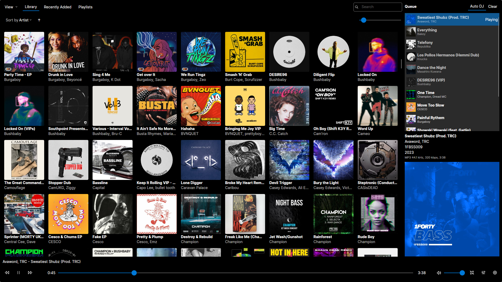
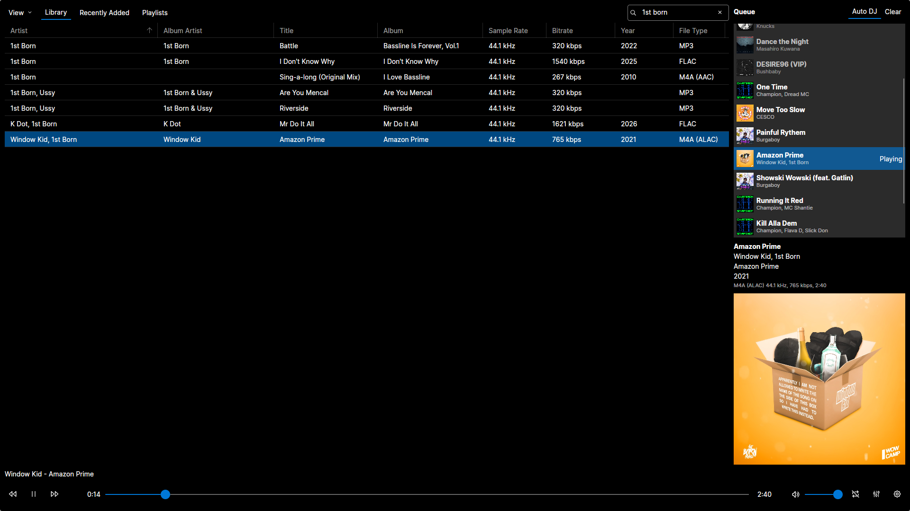
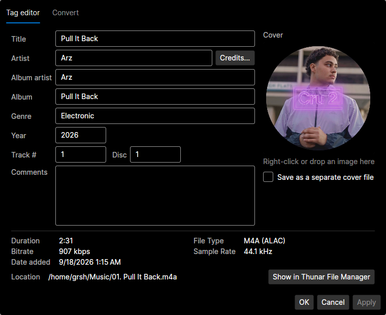
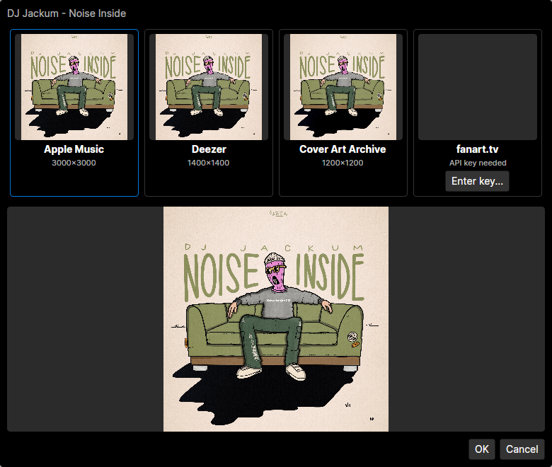
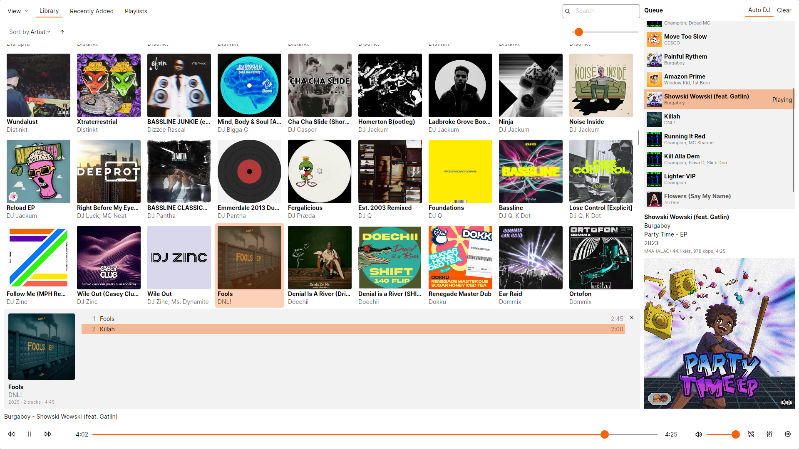

<div align="center">


# SharpSelecta

**An open-source music player for Windows and Linux.**

[](https://github.com/ghorshy/SharpSelecta/actions/workflows/ci.yml)
[](https://github.com/ghorshy/SharpSelecta/releases)
[](https://github.com/ghorshy/SharpSelecta/releases)
[](LICENSE)
<br />
[](https://dotnet.microsoft.com/)
[](https://avaloniaui.net/)
[](#windows)
[](#install)

[Download](https://github.com/ghorshy/SharpSelecta/releases) ·
[Features](#features) ·
[Build from source](#build-from-source) ·
[Report a bug](https://github.com/ghorshy/SharpSelecta/issues)

</div>

---

SharpSelecta is a music player for your local library. It plays MP3, FLAC, ALAC, WAV and more, and lets you fix their tags and covers along the way.

<p align="center">
  
</p>

## Install

Every build is self-contained, so you don't need .NET installed. Download the file for your system from the [Releases page](https://github.com/ghorshy/SharpSelecta/releases).

Packages for Arch (AUR), NixOS and Flathub are on the way, and a macOS version is planned.

### Windows

Run `SharpSelecta-win-Setup.exe`. It adds SharpSelecta to the Start menu and updates itself from then on.

If you'd rather not install anything, extract `SharpSelecta-<version>-win-x64.zip` and run `sharpselecta.exe`. This version doesn't update itself.

### Debian, Ubuntu and Mint

Open the `.deb` in your software center, or install it from a terminal:

```sh
sudo apt install ./sharpselecta_<version>_amd64.deb
```

To update, install the newer `.deb` the same way.

### Fedora

Open the `.rpm` in your software center, or install it from a terminal:

```sh
sudo dnf install ./sharpselecta-<version>-1.x86_64.rpm
```

To update, install the newer `.rpm` the same way.

### AppImage (any Linux)

Nothing gets installed; the file is the whole app:

```sh
chmod +x SharpSelecta-<version>-x86_64.AppImage
./SharpSelecta-<version>-x86_64.AppImage
```

To update, download the newer AppImage and delete the old one.

### Any Linux, without root

The `.tar.gz` comes with a script that installs SharpSelecta just for you, with a menu entry and a `sharpselecta` command:

```sh
tar xzf SharpSelecta-<version>-linux-x64.tar.gz
cd SharpSelecta-<version>-linux-x64
./install.sh
```

The app goes into `~/.local/share/SharpSelecta/app`. To update, run `install.sh` from a newer release. To remove it:

```sh
~/.local/share/SharpSelecta/app/uninstall.sh
```

Your settings and library stay where they are (see [Your data](#your-data)).

### FFmpeg (optional)

Converting between file types (the Convert tab) needs [FFmpeg](https://ffmpeg.org/) on your `PATH`. Everything else works without it. The `.deb` and `.rpm` suggest it, so your package manager may already offer to install it.

## Features

### Library

- Plays MP3, FLAC, WAV, AIFF, Ogg Vorbis and M4A (AAC and ALAC) from one or more folders.
- The library lives in a local index, so it opens instantly and only re-reads files that changed.
- While the app runs it watches your folders and picks up new, edited and deleted files. F5 rescans by hand.
- Renamed or moved files stay in your playlists and queue, and keep their date added.
- Two views: a table where you choose, sort and rearrange the columns, and an album grid you can zoom and sort by title, artist or year. Click an album to open its tracks in the grid; double-click to play it.
- Recently Added lists the newest tracks first.
- Fuzzy search over title, artist and album filters as you type.
- Playlists can be renamed, reordered by dragging, and imported from or exported to M3U/M3U8.

<p align="center">
  
</p>

### Playback

- Drag tracks or whole albums onto the queue, reorder it by dragging, or play something next. Repeat one track or the whole queue.
- Auto DJ tops up the queue with random tracks from the current playlist or the whole library, and doesn't repeat any until it has played them all.
- ReplayGain normalization, per track or per album. Files without the tags get a gain you set.
- 10-band equalizer with presets.
- Optional waveform seek bar. Click the time to switch between elapsed and remaining. The volume slider can be linear or logarithmic.
- Pick the output device. If it disconnects, playback pauses instead of moving to your speakers.
- The next launch brings back the queue, the track and position, the volume and the repeat mode, and can start playing right away.
- A double-click on a track can play it right away, play the list from that point, play just that track or add it to the queue. You choose which, and after how many seconds Previous restarts the track instead of going back.

### Tags and covers

- Edit the usual tags (title, artists, album, album artist, genre, year, track and disc number, comment) and the cover in the Properties window (Alt+Enter), for one track, a selection or a whole album. Covers go into the files or into a cover.jpg next to them.
- A track can have several artists, plus remixer, composer, conductor and lyricist credits.
- Mark albums as compilations with the iTunes flag, and find albums where only some tracks have it.
- Search Apple Music, Deezer, Cover Art Archive and fanart.tv for a cover and compare the results side by side. fanart.tv needs your own free API key.
- Convert to MP3, FLAC, M4A (ALAC or AAC), Ogg Vorbis, WAV or AIFF, one file or a batch at a time. Tags and covers are copied over, except that WAV keeps only title, artist and album. A lossy file can't be converted to a lossless format or to a higher bitrate, and the original stays unless you tell it to go to the trash.
- Show any track or album in your file manager.

<p align="center">
  
  
</p>

### Desktop integration

- Open audio files, folders and M3U playlists from your file manager. If SharpSelecta is already running, they go to that window.
- Minimize or close to the tray. The tray menu has playback controls.
- On Linux, media keys and playerctl work through MPRIS, and you can get a notification with the cover when the track changes.
- A Discord "Listening to" status, off by default. You decide whether it shows the artist, the album and the elapsed time, and whether it stays up while paused.
- Every keyboard shortcut can be rebound.
- Light, dark or custom themes, your own accent color, and adjustable text size.
- The Windows installer keeps itself up to date.

<p align="center">
  
</p>

## Your data

Settings, the library index with your playlists, the saved queue, the cover cache and the logs are all kept in one folder:

- Windows: `%LocalAppData%\SharpSelecta`
- Linux: `~/.local/share/SharpSelecta`

Back it up to keep your settings and playlists. Removing the app on Linux leaves the folder alone, so delete it yourself if you want everything gone.

## What goes online

SharpSelecta works offline and has no accounts or telemetry. It connects to the internet only when:

- you search for a cover. The album and artist name go to Apple Music, Deezer, MusicBrainz with Cover Art Archive, and fanart.tv.
- the Windows installer checks GitHub for a new version. You can turn that off in Settings → Updates.

The Discord status goes to the Discord app on your computer, which shows it to your friends.

## Build from source

You need the .NET 10 SDK.

```sh
git clone https://github.com/ghorshy/SharpSelecta.git
cd SharpSelecta
dotnet build SharpSelecta.slnx
dotnet run --project SharpSelecta.App
```

Run the tests with:

```sh
dotnet test
```

## Built with

- [Avalonia](https://github.com/AvaloniaUI/Avalonia) — cross-platform UI
- [CommunityToolkit.Mvvm](https://github.com/CommunityToolkit/dotnet) — MVVM (observable properties, commands)
- [OwnAudioSharp](https://github.com/ModernMube/OwnAudioSharp) — audio engine (decode, mix, output)
- [ATL.NET](https://github.com/Zeugma440/atldotnet) — reading and writing audio tags
- [Microsoft.Data.Sqlite](https://github.com/dotnet/efcore) — local library index
- [FFMpegCore](https://github.com/rosenbjerg/FFMpegCore) — file type conversion
- [Velopack](https://github.com/velopack/velopack) — Windows installer and updates
- [DiscordRichPresence](https://github.com/Lachee/discord-rpc-csharp) — Discord status
- [Tmds.DBus](https://github.com/tmds/Tmds.DBus) — MPRIS, notifications and tray integration on Linux
- [Serilog](https://github.com/serilog/serilog) — logging
- [Svg.Skia](https://github.com/wieslawsoltes/Svg.Skia) — SVG icon rendering
- [Tabler Icons](https://tabler.io/icons) — icon set
- [TUnit](https://github.com/thomhurst/TUnit) + [NSubstitute](https://github.com/nsubstitute/NSubstitute) — testing

## Contributing

Bug reports and pull requests are welcome. Read [CONTRIBUTING.md](CONTRIBUTING.md) first: a pull request needs tests and has to be tried in the running app.

## AI disclosure

SharpSelecta is built with a lot of help from AI coding assistants, mainly Claude. Every change still goes through a person: it has to pass the tests and get tried in the running app before it's committed.

## License

MIT — see [LICENSE](LICENSE).
